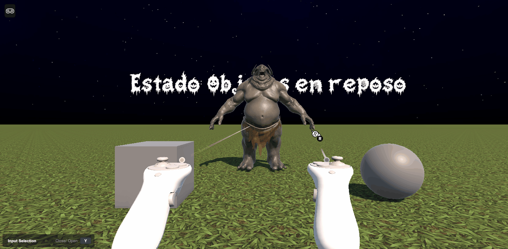
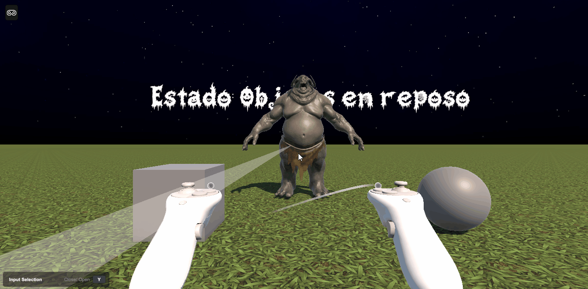

# Práctica 6: Interacción XR con XR Interaction Toolkit y XR Device Simulator

* **Autores:**
  * Bruno Morales Hernández     — alu0101664309@ull.edu.es
  * Francisco Gabriel Ruiz Ruiz — alu0101618586@ull.edu.es
  * Adriel Reyes Suárez         — alu0101640136@ull.edu.es
* **Asignatura:** Interfaces Inteligentes
* **Curso:** 4.º Curso — Ingeniería Informática, ULL — 2026/2027

---

## Descripción

El objetivo de esta práctica es explorar el sistema de interacción de **XR Interaction Toolkit** en Unity. Para ello se ha construido una escena de realidad virtual con varios objetos configurados como **XR Grab Interactable**, que pueden seleccionarse y agarrarse mediante los interactores del XR Origin. La diferencia entre ellos está en la respuesta visual: el cubo y la esfera cambian de color, mientras que el One Eye Monster actualiza un texto 3D. El entorno se ejecuta sin hardware VR gracias al **XR Device Simulator**, que emula el visor y los mandos con teclado y ratón.

El escenario incluye:

* Un plano que actúa como suelo.
* Un cubo y una esfera situados a media y larga distancia, que cambian de color al seleccionarlos.
* Un modelo **One Eye Monster**, situado al alcance de la mano, que actualiza un texto 3D al agarrarlo.
* Un texto flotante de **TextMeshPro** asociado al monstruo.

Los tres objetos comparten la misma configuración de interacción: collider, **Rigidbody** y **XR Grab Interactable**.

---

## Conceptos clave de XR Interaction Toolkit

Antes de describir el montaje conviene fijar los elementos sobre los que se construye la práctica:

* **XR Origin:** rig que representa al usuario en la escena. Contiene la cámara de seguimiento de cabeza y los controladores izquierdo y derecho.
* **Interactor:** componente que detecta y selecciona interactables. El **XR Ray Interactor** selecciona a distancia mediante un rayo, mientras que el **XR Direct Interactor** lo hace por contacto con su esfera de interacción. Ambos pueden actuar sobre el mismo tipo de interactable; la distancia al objeto determina cuál se utiliza.
* **Interactable:** objeto que puede ser seleccionado o agarrado. **XR Grab Interactable** es el componente común a todos los objetos de la escena y añade el comportamiento de agarre físico.
* **Eventos `Select Entered` y `Select Exited`:** se disparan al empezar y al terminar la selección. Permiten ejecutar métodos propios, como cambiar el color de un material o modificar un texto.

En esta práctica, los tres objetos comparten el mismo interactable y los mismos eventos; lo que cambia es el método que se ejecuta en cada uno.

---

## 1. Preparación del proyecto

### 1.1 Entorno y paquetes

El primer paso fue importar los recursos esenciales de TextMesh Pro desde **Window > TextMeshPro > Import TMP Essential Resources**. Este orden es importante: si se instalan antes los paquetes XR, el Package Manager puede entrar en un bucle al resolver dependencias y quedarse bloqueado.

Después se abrió **Window > Package Manager**, se seleccionó el filtro **Unity Registry** y se instalaron, en este orden:

1. XR Plugin Management
2. OpenXR Plugin
3. XR Interaction Toolkit

Durante la instalación aparecieron dos advertencias del validador de OpenXR. Se resolvieron con **Fix / Fix All**, que aplica las correcciones automáticas y deja la configuración lista para continuar.

Por último, en la ficha de XR Interaction Toolkit se abrió la pestaña **Samples** y se importó **Starter Assets**, que incluye los prefabs del XR Origin, los controladores y la configuración de entrada.

### 1.2 Configuración de OpenXR

En **Edit > Project Settings > XR Plug-in Management**, pestaña **Standalone (PC)**, se activó **OpenXR**. Dentro de la subpestaña **OpenXR** se añadió **Oculus Touch Controller Profile** en **Interaction Profiles**.

Finalmente, en **Edit > Project Settings > XR Interaction Toolkit** se marcó **Use XR Device Simulator**. Esta opción permite controlar el visor y los mandos con teclado y ratón durante el modo Play, sin necesidad de un visor físico.

---

## 2. Montaje de la escena y XR Origin

La escena parte de un plano que hace de suelo. Sobre él se arrastró el prefab **Complete XR Origin Setup** desde `Assets/Samples/XR Interaction Toolkit/[Versión]/Starter Assets/Prefabs/`. También puede generarse desde la jerarquía con **XR > Complete XR Origin (VR)**.

Este prefab incorpora el **XR Origin**, la cámara de seguimiento de cabeza y dos controladores. Cada controlador incluye un **XR Ray Interactor** para seleccionar a distancia y un **XR Direct Interactor** para hacerlo por contacto. Ambos interactores actúan sobre el mismo tipo de objeto, de modo que el rig permite interactuar tanto con objetos cercanos como lejanos.

---

## 3. Interacción con los objetos: XR Grab Interactable

Todos los objetos interactuables de la escena se configuraron de la misma forma: conservaron su collider, se les añadió un **Rigidbody** y un **XR Grab Interactable**. Este componente es el que permite seleccionarlos y agarrarlos, y expone los eventos `Select Entered` y `Select Exited`.

La diferencia entre ellos está en la respuesta visual. El cubo y la esfera cambian de color; el One Eye Monster actualiza un texto 3D. La distancia también varía: el cubo y la esfera están a 3 y 5 metros del origen, mientras que el monstruo está cerca del jugador. Esa distancia determina si se alcanzan con el rayo o con la mano, pero no cambia la configuración del interactable.

### 3.1 Configuración común

Los tres objetos mantuvieron su collider geométrico y recibieron un **Rigidbody** y un **XR Grab Interactable**. En los tres casos, los campos *Interaction Manager*, *Colliders* y *Attach Transform* se dejaron vacíos; el componente los resuelve automáticamente al iniciar la escena, enlazándose con el collider del objeto y con el gestor de interacción global.

El cubo y la esfera se colocaron sobre el plano a 3 y 5 metros del origen, respectivamente, sobre el eje Z. El monstruo se situó frente al jugador, a una altura accesible para la mano virtual.

### 3.2 Respuesta al seleccionar: cambio de color

El cubo y la esfera usan el script [`ColorChanger.cs`](Assets/scripts/ColorChanger.cs), que guarda el color original del material y lo sustituye por rojo al recibir `Select Entered`. Cuando llega `Select Exited`, restaura el color inicial. Así, el color actúa como confirmación visual de la selección.

En el **XR Grab Interactable** de cada objeto se enlazaron los siguientes eventos:

* **Select Entered** → `ColorChanger.OnSelectEntered()`
* **Select Exited** → `ColorChanger.OnSelectExited()`

El mismo script funciona en ambos objetos sin configuración adicional.

*Selección del cubo y cambio de color.*

*Selección de la esfera y cambio de color.*

### 3.3 Respuesta al seleccionar: actualización del texto

El **One Eye Monster** se importó desde la Asset Store y se colocó frente al jugador, a una altura accesible. El texto se creó directamente con **GameObject > 3D Object > Text - TextMeshPro**, sin Canvas, y se situó flotando junto al monstruo.

En el **XR Grab Interactable** del monstruo se enlazaron los siguientes eventos:

* **Select Entered** → método dinámico `text (string)` de TextMeshPro con el mensaje `Estado: Tengo al One Eye Monster`.
* **Select Exited** → método dinámico `text (string)` de TextMeshPro con el mensaje `Estado: Ya no tengo al One Eye Monster`.

De esta forma, el texto refleja en todo momento si el monstruo está siendo agarrado.

*Agarre del monstruo y actualización del texto.*

---

## 4. Ejecución y resultados

La práctica se ejecutó en modo Play con el **XR Device Simulator**. La siguiente tabla resume las interacciones comprobadas:

| Objeto | Configuración | Respuesta |
|---|---|---|
| Cubo | XR Grab Interactable | Cambia a rojo al seleccionar y recupera su color al soltar. |
| Esfera | XR Grab Interactable | Cambia a rojo al seleccionar y recupera su color al soltar. |
| One Eye Monster | XR Grab Interactable | Se agarra y el texto TMP indica si está en la mano. |

Las pruebas confirman que los tres objetos comparten el mismo mecanismo de interacción: el **XR Grab Interactable** y los eventos `Select Entered` / `Select Exited`. Lo único que cambia es el método que se ejecuta en cada evento: `ColorChanger` en el cubo y la esfera, y la propiedad `text` de TextMeshPro en el monstruo.

Como conclusión, la práctica muestra que XR Interaction Toolkit permite construir interacciones completas a partir de tres piezas: un interactor, un interactable y los eventos que los comunican. El XR Origin aporta los interactores de rayo y contacto, pero el objeto se configura una sola vez como **XR Grab Interactable**. El XR Device Simulator facilita probar todo el flujo sin disponer de hardware VR.
